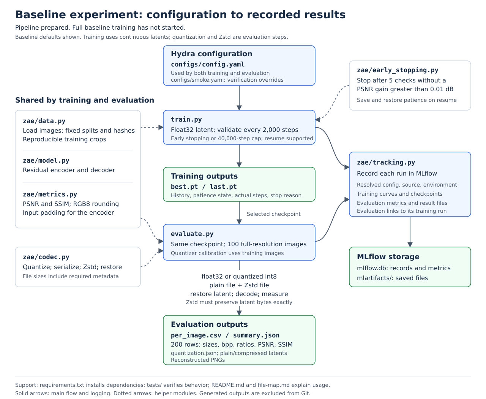

# Baseline experiment file map

All paths below are relative to the project root. The baseline is still untrained;
the existing smoke outputs come from small pipeline verification runs.

## Experiment scope

Two configurations exist: **baseline** (`configs/config.yaml`) and **smoke verification**
(`configs/smoke.yaml`). The baseline plan is one training run followed by one evaluation
run, with separate linked MLflow records. **Training and in-training validation use continuous
float32 latents. Quantization and Zstd happen only during evaluation.**
That evaluation compares four storage conditions using the same checkpoint:
float32 or int8, each without or with Zstd. Quantization-aware training, Zstd-aware
training, and pretrained-codec benchmarks are future work.

## Dataset

Source: [official DIV2K dataset page](https://data.vision.ee.ethz.ch/cvl/DIV2K/).

- [Training images — DIV2K_train_HR.zip](https://data.vision.ee.ethz.ch/cvl/DIV2K/DIV2K_train_HR.zip): 800 high-resolution images; our project splits these into 780 training and 20 internal validation images.
- [Validation images — DIV2K_valid_HR.zip](https://data.vision.ee.ethz.ch/cvl/DIV2K/DIV2K_valid_HR.zip): 100 high-resolution images reserved for our final testing.

Download the **HR** archives; the low-resolution variants are not used by this project.
Local folder locations are listed in [README.md](../README.md) and configured in `configs/config.yaml`.
All 800 training-source images are stored together in `Datasets/DIV2K_train_HR/`;
the config selects 20 of them for validation without moving or copying them.
Validation selects checkpoints and guides tuning; the 100 images in
`Datasets/DIV2K_valid_HR/` remain reserved for final testing.

## Pipeline

Solid arrows show the main flow; dotted arrows show shared code used by a script.
The image is an SVG, so no Mermaid extension is required. Open this file in a local
Markdown preview or view it on GitHub; an online editor cannot load local relative images.

[Open the diagram directly](pipeline.svg) · [Editable Mermaid source](pipeline.mmd)

Inside training: **update weights → validate every 500 steps → save checkpoints →
continue or stop**. Early stopping waits for five consecutive validation checks without
a PSNR gain greater than 0.01 dB over the last significant reference; 5,000 steps is the upper limit. The highest-PSNR
checkpoint remains the one used for final evaluation. Patience is saved for resume.
Warmup lasts 250 steps. At batch size 16, the 5,000-step cap samples 80,000 crops,
approximately 103 crop visits per training image; early stopping can finish sooner.

For each evaluated image: **encode → float32 or quantized int8 latent → save
plain and Zstd versions → restore latent → decode → measure size and quality**.
Zstd must restore the latent bytes exactly; quantized latents are dequantized before decoding.

Support files (`requirements.txt`, tests, package initializers, and documentation)
are explained in the table below; they support the pipeline rather than add processing stages.

## Files created

| File | What it does |
|---|---|
| [`configs/config.yaml`](../configs/config.yaml) | Main Hydra configuration: dataset split, architecture, training, early stopping, validation, quantization, Zstd, evaluation, and MLflow settings. Sets a 5,000-step cap. |
| [`configs/smoke.yaml`](../configs/smoke.yaml) | Smaller model and two training updates, with early stopping disabled. In-training validation uses all 20 held-out images as 32×32 crops; separate evaluation uses two crops. |
| [`configs/__init__.py`](../configs/__init__.py) | Makes the configuration folder importable so Hydra also works when entry points are imported. |
| [`train.py`](../train.py) | Training entry point. Trains and validates with continuous latents, applies early stopping, saves best/latest checkpoints, resumes patience and optimizer state, and logs results to MLflow. |
| [`evaluate.py`](../evaluate.py) | Evaluation entry point. Loads a checkpoint, evaluates float32 and quantized latents before/after Zstd, and saves per-image measurements, summaries, latent files, and reconstructed PNGs. Calibrates quantization using training images. |
| [`zae/model.py`](../zae/model.py) | Defines the agreed residual convolutional autoencoder and PixelShuffle decoder. |
| [`zae/data.py`](../zae/data.py) | Loads RGB images, creates the fixed train/validation/test split, hashes dataset contents, and generates reproducible training crops. |
| [`zae/metrics.py`](../zae/metrics.py) | Calculates PSNR and SSIM; rounds reconstructions to RGB8 and pads inputs for the encoder. |
| [`zae/early_stopping.py`](../zae/early_stopping.py) | Tracks significant validation PSNR improvements and consecutive checks without improvement; saves/restores patience state. |
| [`zae/codec.py`](../zae/codec.py) | Quantizes latents, writes/reads versioned latent files with metadata, and compresses/decompresses their payloads using Zstd. |
| [`zae/tracking.py`](../zae/tracking.py) | Connects to MLflow, records resolved configs and source/environment information, sets seeds/devices, and checks supported configuration values. |
| [`zae/__init__.py`](../zae/__init__.py) | Marks the shared implementation as a Python package. |
| [`tests/test_pipeline.py`](../tests/test_pipeline.py) | Checks model shapes, metrics, quantization, exact latent-file round trips, configuration values, resume safeguards, and summary calculations. |
| [`tests/test_early_stopping.py`](../tests/test_early_stopping.py) | Checks patience, improvement thresholds, disabled stopping, invalid settings, and restoration of stopping state. |
| [`tests/test_training_resume.py`](../tests/test_training_resume.py) | Uses tiny synthetic jobs to verify exact CPU resume, early stopping, final metrics, MLflow stop records, and step-cap behavior. |
| [`requirements.txt`](../requirements.txt) | Lists the Python dependencies and supported version ranges. |
| [`README.md`](../README.md) | Explains setup, commands, outputs, and the measurement protocol. |
| [`.gitignore`](../.gitignore) | Keeps datasets, environments, caches, generated results, and local MLflow storage out of Git. |
| [`documentation/file-map.md`](file-map.md) | This map. |
| [`documentation/pipeline.svg`](pipeline.svg) | Standalone pipeline image; displays without a Mermaid renderer or network access. |
| [`documentation/pipeline.mmd`](pipeline.mmd) | Mermaid version of the pipeline. Maintained alongside the standalone SVG image. |

## Generated files and folders

| Location | Contents |
|---|---|
| `outputs/<experiment>/<timestamp>/` | One invocation's output folder. Contains `config.yaml`, `split_manifest.json`, `environment.json`, `run.json`, and Hydra's `.hydra/` configuration snapshots. |
| Training output folder | `best.pt`, `last.pt` (both include patience state), `history.csv`, `history.json`, and `training_summary.json` with actual steps and stop reason. |
| Evaluation output folder | `per_image.csv`, `summary.json`, and `quantization.json` when quantization is enabled. `latents/` holds plain/compressed latent files; `reconstructions/` holds output PNGs. |
| `mlflow.db` | Local MLflow database containing run metadata, parameters, metrics, and artifact references. |
| `mlartifacts/` | MLflow's saved copies of source files, configurations, checkpoints, and result files. |

The per-image CSV records original PNG/raw RGB sizes, latent payload/file sizes,
Zstd file sizes, reconstruction PNG sizes, PSNR, SSIM, bpp, compression ratios,
quantization clipping, and exact Zstd restoration checks.
Default baseline evaluation produces **200 rows** (100 images × float32/int8), with
both uncompressed and Zstd storage measurements in each row.

The datasets and generated run files are local and excluded from Git. The project
specification remains at the repository root.
