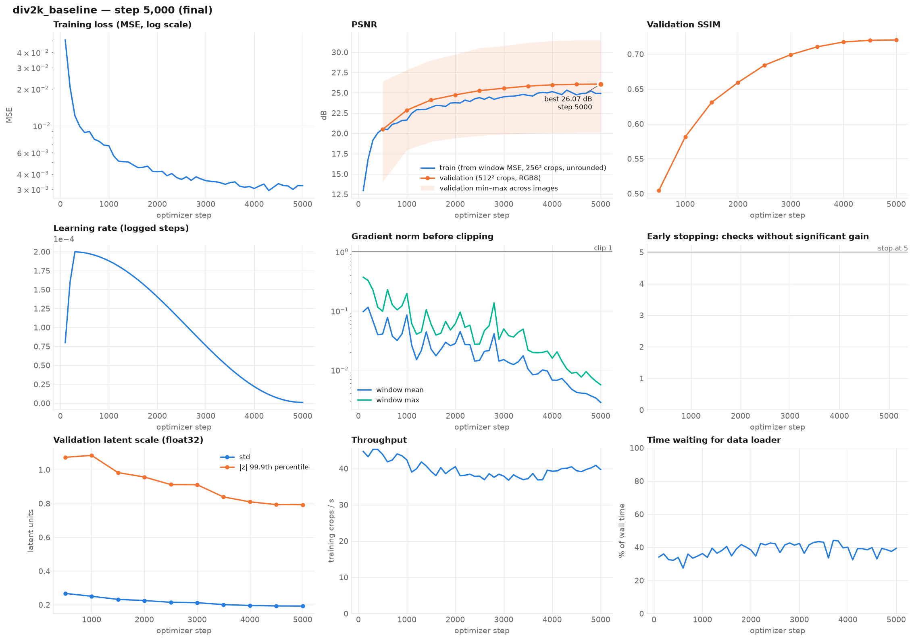
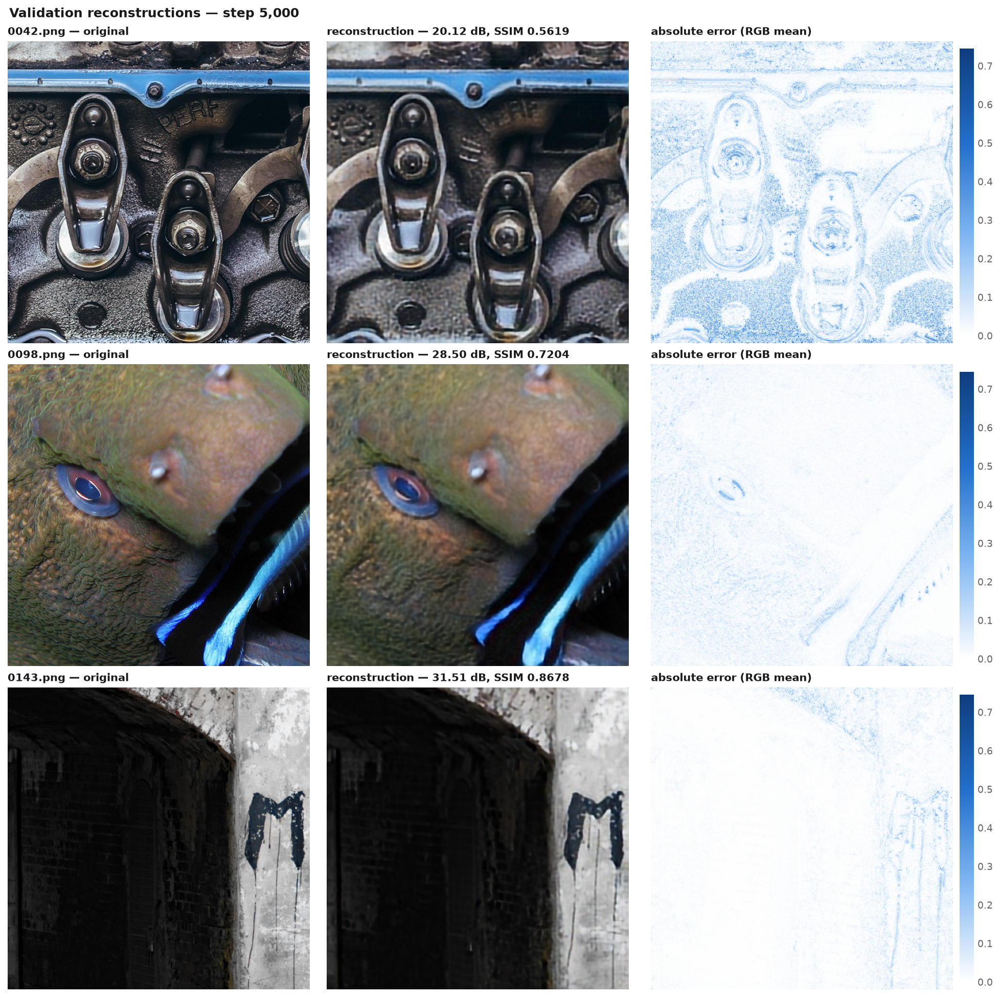
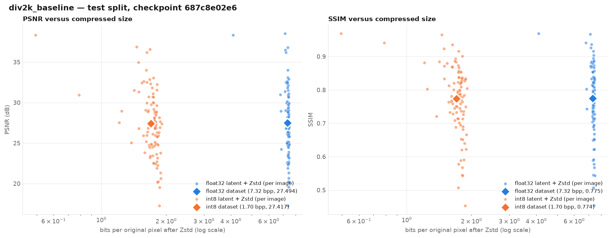
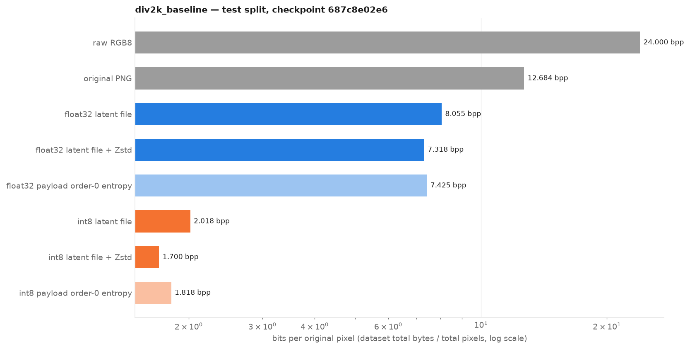
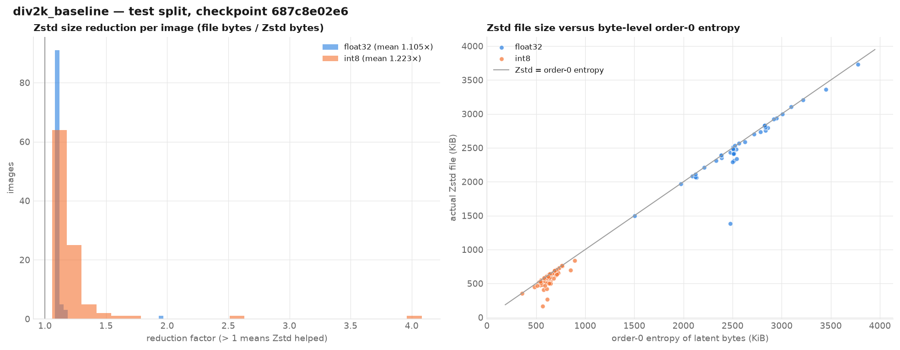
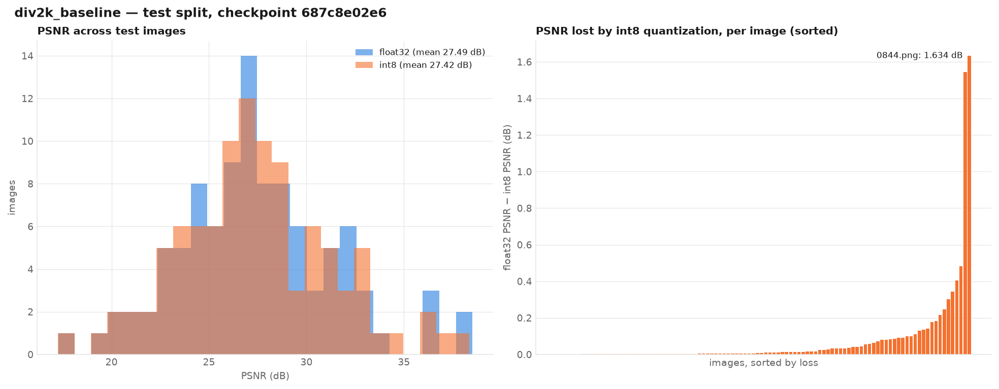
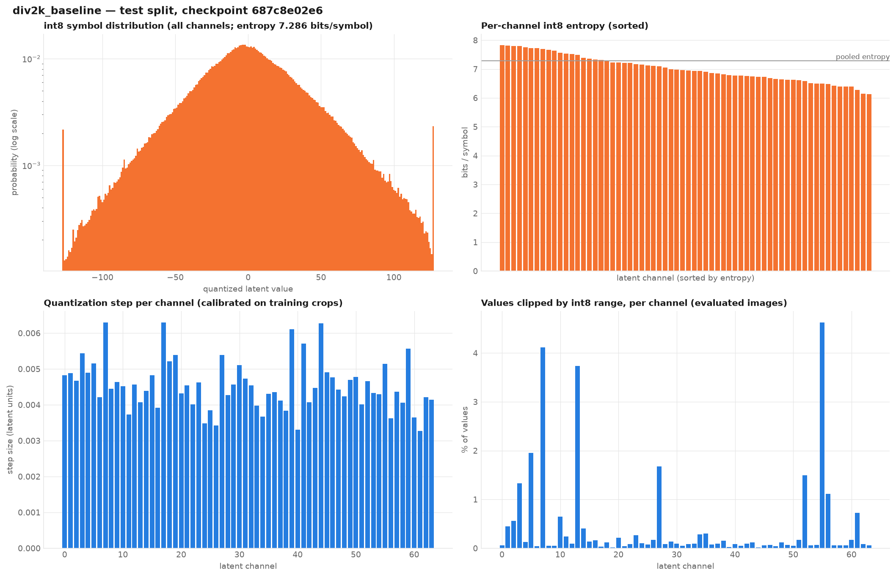
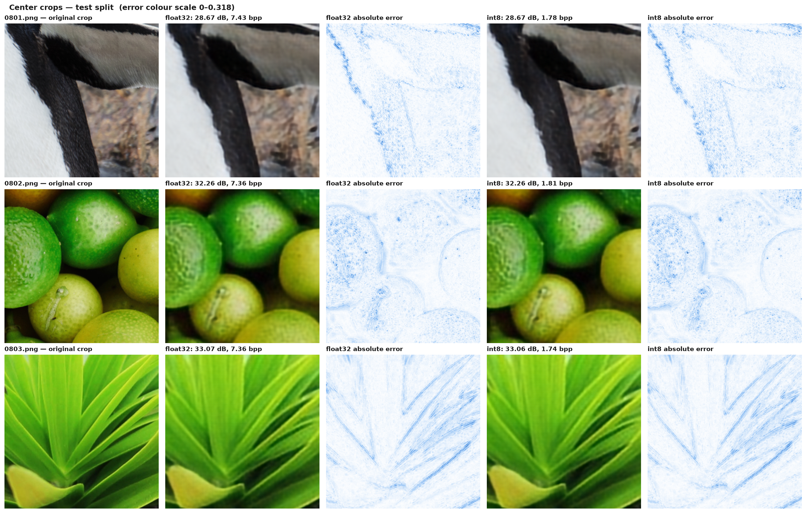

# Baseline results — 5,000-step configuration

The first complete baseline run of the configuration at commit `47feab1` (5,000-step cap,
early stopping), trained and evaluated locally on 2026-11-27. Code: branch
`yacin/verbose-logging-plots`, commit `a63ae8d` (adds logging/plots only — no change
to training settings; the first 100 training steps match the earlier run bit-for-bit).

| | |
|---|---|
| Machine | RTX 4060 Laptop GPU (8 GB), i7-13620H, PyTorch 2.11.0+cu128, float32 |
| Dataset | DIV2K, `dataset_id` `23e6a8fc4190…`; 780 train / 20 validation / 100 test (DIV2K valid) |
| Training | MLflow run `72eb30beaecc4deb87ec0bcc74b29294`, 5,000/5,000 steps, 33 min 45 s, stop reason `max_steps` |
| Evaluation | `best.pt` (step 5,000, sha256 `687c8e02e680…`) on the 100 full-resolution test images |
| Not in Git | `best.pt` / `last.pt` (54 MB each), latent files and reconstruction PNGs — available on request |

## Training

| Step | 500 | 1000 | 1500 | 2000 | 2500 | 3000 | 3500 | 4000 | 4500 | 5000 |
|---|---|---|---|---|---|---|---|---|---|---|
| Val PSNR (dB) | 20.50 | 22.86 | 24.12 | 24.74 | 25.27 | 25.56 | 25.83 | 25.98 | 26.05 | **26.07** |
| Val SSIM | 0.504 | 0.581 | 0.631 | 0.659 | 0.684 | 0.699 | 0.710 | 0.717 | 0.720 | **0.720** |

Every validation improved, so early stopping never triggered (patience stayed 0/5). Gains
shrink mainly because the cosine schedule reaches its 1e-6 floor at step 5,000 — the model
is **not converged** (+0.16 dB between steps 3,500 and 4,000). Training was stable
(gradient norm ≪ clip). The data loader is the bottleneck: the GPU waited for PNG decoding
~35–40% of the time (~2.5 steps/s).

## Evaluation — 100 test images, full resolution

| Representation | PSNR | SSIM | File bpp | + Zstd bpp | Zstd gain | vs original PNG |
|---|---|---|---|---|---|---|
| float32 | 27.49 dB | 0.775 | 8.06 | 7.32 | 1.10× | 1.73× smaller |
| **int8** | **27.42 dB** | **0.774** | **2.02** | **1.70** | **1.19×** | **7.46× smaller** |

Original PNG: 12.68 bpp; raw RGB: 24 bpp. Zstd level 3 restores latent bytes exactly in all 200 files.

## Observations

1. **int8 quantization is almost free:** −0.08 dB mean. A few outliers (0844: −1.63 dB) come
   from clipping.
2. **Clipping:** 0.44% of values hit ±127 on average, but 4.6% in channel 55 and ~4% in
   channels 7 and 13 (spikes at ±127 in the symbol histogram). Scales calibrated at p99.9 on
   center crops of 20 training images underestimate the full-image range.
3. **Latents are close to incompressible for Zstd:** int8 symbols have 7.29 bits/symbol of
   entropy (out of 8), a wide bell shape with only 1.3% zeros → Zstd saves only 16%.
4. **Zstd beats order-0 entropy** (1.70 vs 1.82 bpp): LZ matching exploits spatial
   repetition (two flat images compress 2.5× and 4×), so the *arrangement* of latents
   matters, not only their histogram.
5. **Quality is weak:** 27.4 dB mean, ranging ~17–38 dB per image; textures are visibly smoothed.

## Points to decide before models A and B

1. **Baseline budget.** The model is undertrained. Proposal: a 20–40k-step run (≈2–4.5 h on
   this machine) as the common checkpoint, or keep 5k and state the limitation.
2. **Freeze the quantizer for all models.** Per-model recalibration would rescale any
   latent shrinkage learned by model B back to the full int8 range and erase its gain. Use
   one fixed step size, or reuse one `quantization.json` (this run's is in
   `evaluation/quantization.json`), and calibrate on more/full images to reduce clipping.
3. **Model A needs its own rate–distortion curve.** Because int8 costs only 0.08 dB, the
   quantization step is much finer than needed; a coarser step alone would shrink A's files
   a lot. A must be swept over quantization steps, otherwise B is compared against a weak
   single point.
4. **Run all A/B/λ experiments on one machine** so hardware differences are not a confound.

## Files

- `training/`: resolved config, environment, `history.csv/json` (reproducible metrics),
  `performance.json` (throughput, data wait, GPU memory), `training_summary.json`,
  `model_summary.txt`, `train.log`, `split_manifest.json`.
- `evaluation/`: `summary.json`, `per_image.csv` (200 rows), `quantization.json`,
  `latent_stats.json` (int8 symbol counts, per-channel entropy, clipping, float stats),
  `evaluate.log`.
- Regenerate plots from a full output directory: `python -m zae.plots {training|evaluation} <dir>`.
