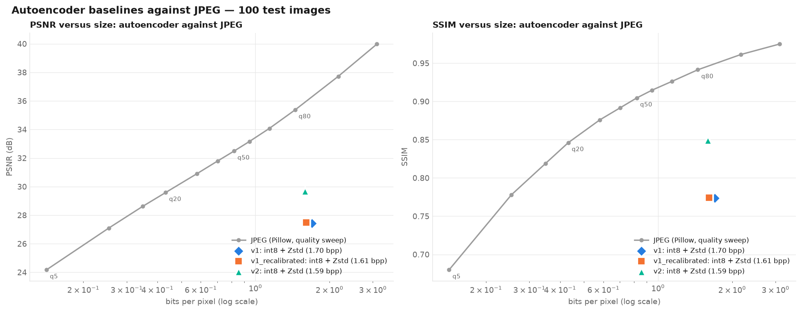
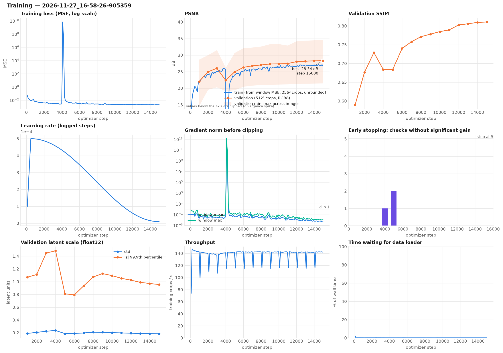

# Baseline v2 — same architecture, same wall-clock budget, better use of it

Baseline v2 keeps v1's architecture, loss, data split and evaluation protocol
([`results/baseline_5k`](../baseline_5k/README.md)) and changes only how the ~30 minutes of
GPU time are used, plus the quantizer calibration. Config:
[`configs/baseline_v2.yaml`](../../configs/baseline_v2.yaml); branch `yacin/baseline-v2`.
All runs on the same machine (RTX 4060 Laptop GPU), same dataset (`dataset_id` `23e6a8fc4190…`).

| Change vs v1 | Why |
|---|---|
| Training images decoded once into RAM (`data.cache_images`) | v1 spent ~38% of its time waiting for PNG decoding. Crops are bit-identical (tested). |
| bfloat16 autocast for the training forward pass, `cudnn.benchmark`, `channels_last` | 9.5 vs 4.4 steps/s measured on this GPU. Validation and evaluation remain float32. |
| 15,000 steps instead of 5,000; validation every 1,000; warmup 500 | Same wall time: 29 min 19 s vs 33 min 45 s for v1. |
| Peak learning rate 5e-4 (was 2e-4), floor 1e-5 (was 1e-6) | Faster progress, no steps wasted at a near-zero learning rate. **Too high: see divergence below.** |
| Quantizer calibrated on 100 whole training images at p99.99 (was center crops of 20 at p99.9) | v1 clipped up to 4.6% of some channels, costing up to 1.6 dB on some images. |

## Results — 100 test images, full resolution, int8 + Zstd (level 3)

| | Training | bpp after Zstd | PSNR | SSIM | int8 loss mean / worst | Clipped values |
|---|---|---|---|---|---|---|
| v1 | 5k steps, 33.8 min | 1.700 | 27.42 dB | 0.774 | 0.077 / 1.634 dB | 0.44% (max channel 4.6%) |
| v1 with v2 calibration | (same checkpoint) | 1.611 | 27.49 dB | 0.774 | 0.004 / 0.033 dB | 0.011% (max 0.06%) |
| **v2** | 15k steps, 29.3 min | **1.591** | **29.67 dB** | **0.849** | 0.011 / 0.079 dB | 0.011% (max 0.04%) |
| JPEG at the same bpp (interpolated) | — | 1.59 | 35.83 dB | ≈0.945 | — | — |

Per-image int8 PSNR for v2 ranges from 20.1 to 41.6 dB (v1: 17.3 to 38.5 dB). The float32
latents give 29.68 dB, so quantization now costs 0.01 dB. Checkpoint: `best.pt` (step 15,000),
sha256 `19bc025d5443…`; MLflow training run `85ce892d05b6431f9794d444ac0210bc`, evaluation run `9791406d9cda48d5b4452b28ff1d264e`.

| | JPEG PSNR at the same bpp | Gap | JPEG bpp for the same PSNR | Bits used vs JPEG |
|---|---|---|---|---|
| v1 | 36.19 dB | −8.77 dB | 0.274 | 6.21× |
| v1 with v2 calibration | 35.90 dB | −8.41 dB | 0.278 | 5.79× |
| **v2** | 35.83 dB | **−6.16 dB** | 0.441 | **3.61×** |

JPEG curve: Pillow/libjpeg, 4:2:0 chroma subsampling, optimized Huffman tables, quality
5–95, same images and metrics as the autoencoder
([`jpeg_reference/`](jpeg_reference/), produced by `jpeg_reference.py`).

## What each change contributed

- **Calibration alone** (same v1 weights): quantization loss 0.077 → 0.004 dB, worst image
  1.63 → 0.03 dB. Files also got **5% smaller** (1.700 → 1.611 bpp): the larger p99.99 step
  lowers symbol entropy (6.95 vs 7.29 bits). This shows that **calibration choices change
  the bitrate by themselves**, so it must be frozen and identical for models A and B.
- **Training changes:** +2.18 dB PSNR and +0.075 SSIM in slightly less time.

## Training — and a divergence

At step ~4,050 (learning rate 4.3e-4) training **diverged**: window MSE jumped from 0.0027
to 6.5e9 and the gradient norm to 1.3e13. Gradient clipping let the model recover, but MSE
only returned to the pre-spike level around step 6,000, so **~2,000 of the 15,000 steps were
lost** (validation PSNR: 26.04 at 3k → 22.40 at 4k → 26.30 at 6k). v1 at 2e-4 never diverged.
The architecture has no normalization layers, so it is sensitive to the learning rate.
Training now logs a warning when a spike occurs.

| Step | 1k | 2k | 3k | 4k | 5k | 6k | 8k | 10k | 12k | 13k | 14k | 15k |
|---|---|---|---|---|---|---|---|---|---|---|---|---|
| Val PSNR | 22.05 | 24.97 | 26.04 | 22.40 | 24.90 | 26.30 | 27.03 | 27.36 | 28.04 | 28.17 | 28.28 | **28.34** |

Throughput: ~142 crops/s with 0% data wait (v1: ~40 crops/s with 35–40% wait).

## Against the proposed thresholds

| Criterion | Target | v1 | v2 | Status |
|---|---|---|---|---|
| Test PSNR (int8 + Zstd) | ≥ 30 dB | 27.42 | 29.67 | 0.33 dB short |
| Test SSIM | ≥ ≈0.85 | 0.774 | 0.849 | borderline |
| int8 cost (mean / worst) | < 0.1 / < 0.3 dB | 0.077 / 1.63 | 0.011 / 0.079 | **met** |
| Converged (< 0.05 dB per 1k steps at a meaningful learning rate) | | no | no: +0.11 at 13→14k; +0.06 at 14→15k as the rate reaches its floor | **not met** |

## Recommendation

1. **v2.1, about 30 minutes:** the same configuration with peak learning rate **3e-4**. It avoids
   the divergence and recovers the ~2,000 lost steps; it should reach ≥30 dB.
2. If v2.1 is still rising at the end, give it one longer overnight run (e.g. 40k steps ≈ 75 min
   at the v2 speed) and use that checkpoint as the common starting point for A and B.
3. Freeze the quantizer (this file's `evaluation/quantization.json` or a fixed step) for every
   A/B evaluation; calibration alone moved the bitrate by 5%.
4. The autoencoder still needs 3.6× more bits than JPEG for the same PSNR. That is expected
   for a model without entropy modelling. The A/B study measures relative effects, but the report
   should show this JPEG reference.

## Files

`training/`: config, history, performance, summary, log, model summary · `evaluation/`: v2 test
summary, per-image CSV, `quantization.json`, latent statistics, log, plots ·
`v1_recalibrated/`: v1 checkpoint evaluated with v2 calibration · `jpeg_reference/`: JPEG
per-image CSV and curve · `jpeg_comparison.png/.json`: all baselines against JPEG
(`python -m zae.plots jpeg <jpeg_summary.json> <out.png> label=<summary.json> ...`).
