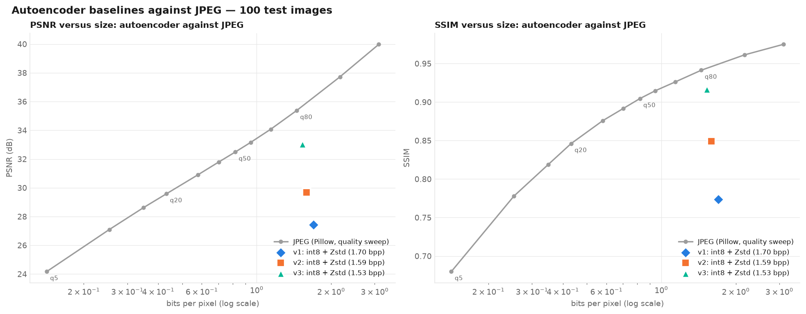
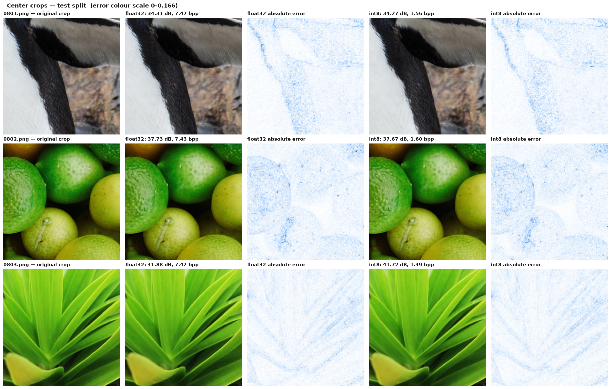
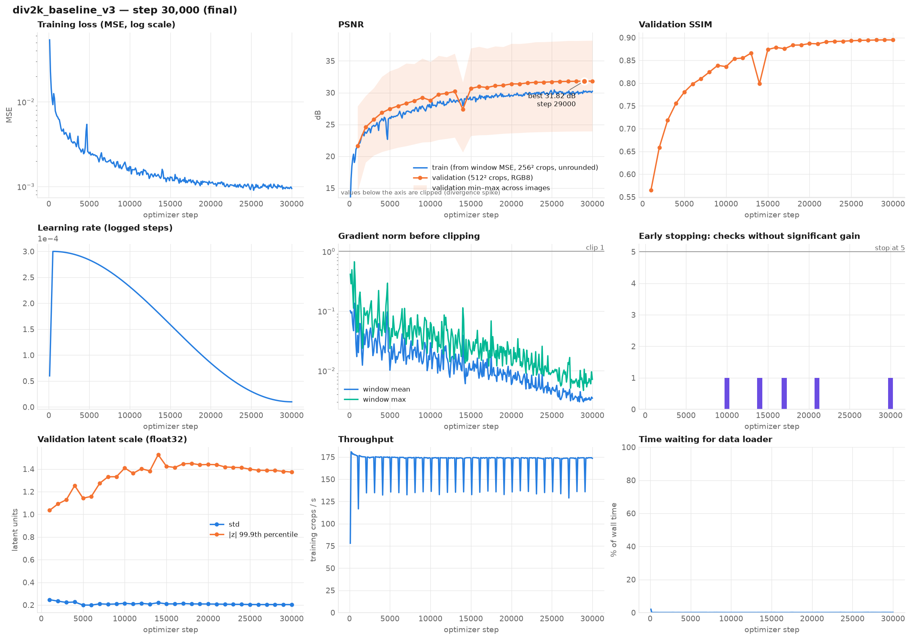

# Baseline v3: the best result within a single run of under an hour

v3 is the proposed **common starting checkpoint for models A and B**. Architecture, loss, data
split and evaluation protocol are the same as v1 and v2. Only the use of the GPU budget and the
quantizer calibration changed. Config: [`configs/baseline_v3.yaml`](../../configs/baseline_v3.yaml)
(inherits [`baseline_v2.yaml`](../../configs/baseline_v2.yaml)); branch `yacin/baseline-v2`.
Same machine (RTX 4060 Laptop GPU) and dataset (`dataset_id` `23e6a8fc4190…`) as v1 and v2.

| Version | Settings | Steps | Wall time |
|---|---|---|---|
| v1 ([results](../baseline_5k/README.md)) | float32, PNG decoded per sample, lr 2e-4 → 1e-6, crop calibration p99.9 | 5,000 | 33.8 min |
| v2 ([results](../baseline_v2/README.md)) | + images decoded once into RAM, bf16 training, channels_last, cudnn.benchmark, lr 5e-4 → 1e-5, whole-image calibration p99.99 | 15,000 | 29.3 min |
| **v3** | v2 + **lr 3e-4**, **spike guard** (skip updates with gradient norm > 100), **torch.compile** (+21%) | **30,000** | **47.9 min** |

## Results: 100 test images, full resolution, int8 latents + Zstd level 3

| | bpp after Zstd | PSNR | SSIM | vs original PNG | Gap to JPEG at the same bpp | Bits vs JPEG at the same PSNR |
|---|---|---|---|---|---|---|
| v1 | 1.700 | 27.42 dB | 0.774 | 7.5× smaller | −8.77 dB | 6.21× |
| v2 | 1.591 | 29.67 dB | 0.849 | 8.0× smaller | −6.16 dB | 3.61× |
| **v3** | **1.531** | **33.05 dB** | **0.916** | **8.3× smaller** | **−2.59 dB** | **1.66×** |

- v3 gains **+5.6 dB over v1** with files 10% smaller. Its PSNR matches JPEG at quality ≈ 58,
  which needs 0.92 bpp, so v3 uses 1.66× JPEG's bits for the same PSNR. JPEG reference: Pillow, 4:2:0, optimized Huffman
  tables, same images and metrics ([`../baseline_v2/jpeg_reference/`](../baseline_v2/jpeg_reference/)).
- Quantization costs 0.042 dB on average (float32: 33.09 dB), at most 0.26 dB on one image.
  Clipping is at most 0.046% per channel.
- Per-image int8 PSNR ranges from 22.7 to 45.6 dB.
- The latents are more compressible than v1's: int8 symbol entropy is 6.37 bits (v1: 7.29),
  3.6% zeros, and Zstd saves 24% (v1: 16%). The latent distribution is now a sharp peak at
  zero with heavy tails. That is exactly the structure a Zstd-aware loss (model B) would try
  to strengthen.

## Training

| Step | 3k | 6k | 9k | 12k | 15k | 18k | 21k | 24k | 27k | 29k (best) | 30k |
|---|---|---|---|---|---|---|---|---|---|---|---|
| Val PSNR | 25.79 | 27.91 | 29.24 | 29.90 | 30.67 | 31.10 | 31.38 | 31.64 | 31.78 | **31.82** | 31.82 |
| Val SSIM | 0.718 | 0.798 | 0.839 | 0.855 | 0.874 | 0.883 | 0.886 | 0.892 | 0.894 | **0.895** | 0.895 |

- **No divergence.** The largest gradient norm in any window was 0.67, so the spike guard
  (limit 100) never had to act (0 skipped updates).
- Two short wobbles at the peak learning rate, both fully recovered by the next validation:
  training MSE rose from 0.0029 to 0.0054 at steps 4.5–4.7k, and validation PSNR dropped
  −2.8 dB at step 14k (MSE 0.0013 → 0.0016). 3e-4 is close to the stability limit of this
  architecture, which has no normalization layers.
- The last gains were +0.019 to +0.027 dB per 1,000 steps. That meets the < 0.05 dB
  convergence criterion, but only because the learning rate had reached its floor. A longer
  schedule would still add some quality (see below).
- Throughput: ~174 crops/s, 0% data wait (v1: ~40 crops/s with 35–40% wait).

## Against the proposed thresholds

| Criterion | Target | v1 | v2 | v3 |
|---|---|---|---|---|
| Test PSNR | ≥ 30 dB | 27.42 | 29.67 | **33.05 ✔** |
| Test SSIM | ≥ ≈0.85 | 0.774 | 0.849 | **0.916 ✔** |
| int8 cost, mean / worst | < 0.1 / < 0.3 dB | 0.077 / 1.63 | 0.011 / 0.08 | **0.042 / 0.26 ✔** |
| Gain over the last 1k steps | < 0.05 dB | no | no | **0.00–0.03 ✔** (end of schedule) |

## Artefacts and identifiers

- Checkpoint `best.pt` (step 29,000), sha256 `c0b599727af7…`, 54 MB. Not in Git; shared on request.
- MLflow training run `8ef98742291b4eca955a4da610a4c97e`, evaluation run `5436f3bca3d24b3e9d0f37b23524a194`.
- **Quantizer to freeze for the A/B phase:** [`evaluation/quantization.json`](evaluation/quantization.json)
  (100 whole training images, p99.99). Use it via
  `quantization.calibration_file=results/baseline_v3/evaluation/quantization.json`.

## Limits and what would improve it further

- The remaining 2.6 dB gap to JPEG comes from the architecture and from not modelling entropy
  (no entropy model, plain Zstd on int8), not from training. Wider layers, normalization (e.g. GDN)
  or a learned entropy model would change the agreed baseline itself.
- A longer schedule (e.g. 60k steps ≈ 95 min) would likely add a few tenths of a dB. This was
  deliberately not run (budget: one run under an hour).

## Files

`training/`: config, environment, history, performance, summary, log, model summary,
plots · `evaluation/`: summary, per-image CSV (200 rows), `quantization.json`, latent
statistics, log, plots · `jpeg_comparison.png/.json`: v1/v2/v3 placed on the JPEG curve.
